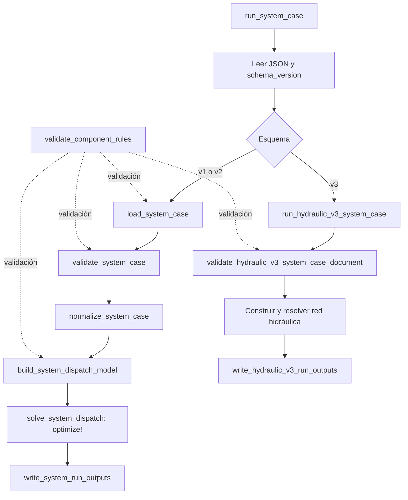

# Guía del motor Julia: `system_dispatch.jl` y `component_rules.jl`

Esta guía explica cómo se carga un caso, se validan sus reglas, se construye el modelo matemático, se ejecuta HiGHS y se escriben los resultados. Describe la implementación actualizada al **15 de octubre de 2026**, incluidos los caudales propios de los tramos y la filtración según cota.

Las fuentes principales son [system_dispatch.jl](../src/system_dispatch.jl) y [component_rules.jl](../src/component_rules.jl). Las referencias indican funciones y líneas de esa versión. Los bloques identificados como **extracto del código** se copian directamente del archivo; las ecuaciones y los ejemplos identificados como ilustrativos explican su comportamiento.

## Índice

1. [Responsabilidades y recorrido completo](#responsabilidades)
2. [Mapa de los archivos](#mapa)
3. [Estructuras, índices y unidades](#estructuras)
4. [Carga, validación y normalización de v1/v2](#entrada)
5. [Construcción del modelo eléctrico e hidro de v1/v2](#modelo)
6. [Resolución y artefactos de salida](#resultados)
7. [Ruta hidráulica v3](#hidraulica-v3)
8. [Contrato de component_rules](#contrato)
9. [Validación de objetos, filas y términos](#validacion-reglas)
10. [Reglas temporales](#temporales)
11. [Restricciones acumuladas por ventana](#ventanas)
12. [Detección anticipada de contradicciones](#contradicciones)
13. [Conversión de reglas a restricciones JuMP](#integracion)
14. [Ejemplo de extremo a extremo y comandos](#ejemplo)
15. [Errores, límites y detalles que importan al modificar el código](#limites)
16. [Pruebas existentes y mantenimiento de esta guía](#pruebas)

<a id="responsabilidades"></a>

## 1. Responsabilidades y recorrido completo

`system_dispatch.jl` implementa el despacho: interpreta los datos del sistema, crea variables y restricciones JuMP, define el objetivo, llama al solver y transforma la solución en archivos CSV y JSON.

`component_rules.jl` valida un bloque opcional de restricciones adicionales, llamado `component_rules`. Comprueba compatibilidad, identidad de los objetos, períodos, unidades, coeficientes y algunas contradicciones. Las restricciones ya llegan expresadas como sumas afines: una constante más una suma de variables multiplicadas por coeficientes numéricos.

Ambos archivos se incluyen dentro del módulo `BESSDispatch`, junto con los tipos y utilidades compartidos. Aunque `component_rules.jl` se incluye después de `system_dispatch.jl`, las llamadas a sus funciones se realizan cuando el módulo ya terminó de cargarse.

**Extracto del código:** [BESSDispatch.jl, líneas 1–8](../src/BESSDispatch.jl#L1).

<!-- source: ../src/BESSDispatch.jl:1-8 -->

```julia
module BESSDispatch

include("types.jl")
include(joinpath("io", "loaders.jl"))
include(joinpath("model", "base_model.jl"))
include(joinpath("results", "writer.jl"))
include("system_dispatch.jl")
include("component_rules.jl")
```

Hay dos recorridos de ejecución:



En v1/v2 las etapas principales tienen funciones y estructuras separadas. En v3, `run_hydraulic_v3_system_case` concentra la preparación de datos, la construcción del modelo, la resolución y la preparación de la salida.

La entrada común decide la ruta por `schema_version`:

**Extracto del código:** [system_dispatch.jl, líneas 1478–1493](../src/system_dispatch.jl#L1478).

<!-- source: ../src/system_dispatch.jl:1478-1493 -->

```julia
function run_system_case(
    path::AbstractString;
    output_root::AbstractString = "outputs",
    run_timestamp = nothing,
)::SystemRunOutput
    resolved_path = resolve_system_case_path(path)
    document = read_system_case_document(resolved_path)
    if string(get(document, "schema_version", "")) == SYSTEM_SCHEMA_VERSION_V3
        return run_hydraulic_v3_system_case(
            document,
            resolved_path;
            output_root,
            run_timestamp,
        )
    end
```

Una consecuencia práctica: `load_system_case` y `normalize_system_case` pertenecen al recorrido v1/v2. Para ejecutar un documento v3 se utiliza `run_system_case`, que lo deriva a la implementación hidráulica.

<a id="mapa"></a>

## 2. Mapa de los archivos

### `system_dispatch.jl`

| Bloque | Referencia | Responsabilidad |
| --- | --- | --- |
| Dependencias, versiones y unidades | [L1](../src/system_dispatch.jl#L1) | Importa JuMP, HiGHS, CSV, JSON3 y PiecewiseLinearOpt; declara los esquemas. |
| Estructuras | [L19](../src/system_dispatch.jl#L19) | Grafo, parámetros, datos normalizados, modelo, resultado y rutas de salida. |
| Carga y validación v1/v2 | [L191](../src/system_dispatch.jl#L191) | JSON → `SystemGraphData`; comprueba grafo y datos. |
| Validación hidráulica v3 | [L273](../src/system_dispatch.jl#L273) | Valida nodos, tramos, centrales, unidades, curvas y series. |
| Normalización v1/v2 | [L657](../src/system_dispatch.jl#L657) | Convierte activos y series en vectores y matrices tipados. |
| Parámetros de activos | [L751](../src/system_dispatch.jl#L751) | Lectura de renovables, red, baterías e hidro y validación de curvas. |
| Construcción del modelo v1/v2 | [L1029](../src/system_dispatch.jl#L1029) | Variables, restricciones físicas, objetivo y reglas adicionales. |
| Resolución v1/v2 | [L1387](../src/system_dispatch.jl#L1387) | Ejecuta el solver, extrae valores y calcula magnitudes derivadas. |
| Entrada común | [L1478](../src/system_dispatch.jl#L1478) | Selecciona ruta según esquema y coordina la ejecución. |
| Ejecución hidráulica v3 | [L1516](../src/system_dispatch.jl#L1516) | Modelo de red hidráulica y resolución. |
| Salidas y utilidades v3 | [L1867](../src/system_dispatch.jl#L1867) | Archivos, interpolación de cotas, tablas, resumen y metadatos. |
| Escritura v1/v2 | [L2166](../src/system_dispatch.jl#L2166) | Genera los cinco artefactos principales. |
| Lectores y validadores auxiliares | [L2204](../src/system_dispatch.jl#L2204) | Rutas, nodos, conexiones, precios, conectividad y series. |
| Cotas y cálculos auxiliares | [L2475](../src/system_dispatch.jl#L2475) | Límites de red, variación de energía, volúmenes y curvas. |
| Tablas y resumen v1/v2 | [L2610](../src/system_dispatch.jl#L2610) | Agregados por período, detalle por activo y métricas. |
| Reconstrucción del caso y utilidades | [L3140](../src/system_dispatch.jl#L3140) | Serialización del caso y lectura de valores requeridos/opcionales. |

### `component_rules.jl`

| Bloque | Referencia | Responsabilidad |
| --- | --- | --- |
| Versiones y adaptadores | [L1](../src/component_rules.jl#L1) | Define los contratos reconocidos. |
| `validate_budget_window` | [L9](../src/component_rules.jl#L9) | Valida una ventana temporal de acumulación. |
| Entrada, compatibilidad y grilla | [L39](../src/component_rules.jl#L39) | Detecta reglas, valida contrato y compara el horizonte. |
| Políticas temporales | [L74](../src/component_rules.jl#L74) | Revisa la política del primer período y obtiene las ventanas. |
| Objetos y pertenencia | [L87](../src/component_rules.jl#L87) | Vincula IDs de reglas con componentes reales del caso. |
| Filas y términos | [L128](../src/component_rules.jl#L128) | Revisa procedencia, operadores, variables, unidades y períodos. |
| Contradicciones sencillas | [L202](../src/component_rules.jl#L202) | Reduce coeficientes repetidos e intersecta cotas de una variable. |

<a id="estructuras"></a>

## 3. Estructuras, índices y unidades

### 3.1. De datos de entrada a resultados

| Tipo | Contenido y uso |
| --- | --- |
| `SystemNode` | ID, tipo y diccionario de atributos de un nodo eléctrico o activo. |
| `SystemEdge` | Campos `from` y `to` para conectividad lógica v1/v2. |
| `SystemPeriodData` | Fecha, duración, precios y diccionarios de disponibilidad, demanda y afluentes. |
| `SystemGraphData` | Caso v1/v2 con nodos, conexiones, períodos, solver, ruta de origen y reglas opcionales. |
| `BatteryAssetParameters` | ID, parámetros `BESSParameters` y restricciones `ConstraintConfig`. |
| `RenewableAssetParameters` | ID y penalización por recorte. |
| `GridAssetParameters` | Límites de importación/exportación y política de simultaneidad. |
| `HydroAssetParameters` | Almacenamiento, caudal, generación, curvas, vertimiento y condición terminal. |
| `SystemOptimizationData` | Datos v1/v2 normalizados; conserva también el grafo original en `graph`. |
| `SystemDispatchModel` | Modelo JuMP y matrices de referencias a sus variables. |
| `SystemDispatchResult` | Valores numéricos, estados del solver y magnitudes físicas/económicas calculadas. |
| `SystemRunOutput` | Resultado más directorio, marca de ejecución y rutas de los archivos escritos. |

El campo que transporta las reglas aparece en el grafo:

**Extracto del código:** [system_dispatch.jl, líneas 42–55](../src/system_dispatch.jl#L42).

<!-- source: ../src/system_dispatch.jl:42-55 -->

```julia
struct SystemGraphData
    schema_version::String
    case_name::String
    nodes::Vector{SystemNode}
    edges::Vector{SystemEdge}
    time_series::Vector{SystemPeriodData}
    constraints::Dict{String,Any}
    solver::SolverConfig
    source_path::Union{String,Nothing}
    component_rules::Union{Dict{String,Any},Nothing}
end

SystemGraphData(schema, name, nodes, edges, periods, constraints, solver, path) =
    SystemGraphData(schema, name, nodes, edges, periods, constraints, solver, path, nothing)
```

El constructor corto de compatibilidad inicializa `component_rules` en `nothing`. Así, los casos que no incluyen reglas pueden recorrer el mismo flujo.

### 3.2. Orientación de las matrices

En v1/v2 las matrices de activos tienen la forma:

```text
variable[índice_del_activo_dentro_de_su_tipo, índice_del_período]
```

Por ejemplo, `p_battery_charge_mw[2, 3]` es la potencia de carga de la segunda batería en el tercer período. El orden de los activos se deriva del recorrido de los nodos durante la normalización. Un ID de objeto de reglas, como `7`, no representa directamente la fila 7 de esa matriz: primero debe resolverse a su activo.

Los períodos del JSON de reglas empiezan en **0**. Los arrays Julia empiezan en **1**. En la traducción al modelo se usa `term["period"] + 1`. En v3 las matrices de potencia/caudal turbinado tienen filas de **unidades**, mientras que las de almacenamiento/vertimiento/cota tienen filas de **embalses**; sus primeras dimensiones pueden ser distintas.

### 3.3. Unidades y estados al final del período

| Magnitud | Unidad |
| --- | --- |
| Potencia eléctrica | MW |
| Energía de batería y energía producida | MWh |
| Precios eléctricos v1/v2 | USD/MWh |
| Caudal | m³/s |
| Almacenamiento y volumen de agua | hm³ |
| Cota de embalse | metros sobre el nivel del mar, `masl` |
| Duración | horas |
| Penalización de vertimiento y valor terminal del agua | USD/hm³ |

La constante `HM3_PER_M3S_HOUR`, declarada en [L17](../src/system_dispatch.jl#L17), vale `3600 / 1_000_000 = 0.0036`. Por eso:

```text
energía_MWh = potencia_MW × duración_h
volumen_hm³ = caudal_m³/s × duración_h × 0.0036
```

La energía de batería y el almacenamiento hidráulico representados en el período `t` son los estados **después de aplicar los flujos de ese período**. El estado inicial se usa como antecedente del primer período, sin crear una columna adicional para él.

<a id="entrada"></a>

## 4. Carga, validación y normalización de v1/v2

### 4.1. `load_system_case`: lectura del JSON

[La función comienza en L191](../src/system_dispatch.jl#L191). Su recorrido es:

1. `resolve_system_case_path` acepta una ruta de archivo o un directorio; en este último busca `system_case.json`.
2. Lee el documento con JSON3; los errores de lectura/parseo se envuelven en un `ArgumentError`.
3. Ejecuta `validate_component_rules(document)` sobre el documento leído.
4. Convierte nodos, conexiones, períodos y configuración del solver a estructuras Julia.
5. Conserva `component_rules` en `SystemGraphData`.
6. Llama a `validate_system_case` y devuelve el grafo validado.

### 4.2. `validate_system_case`: coherencia del sistema

[El bloque de L216](../src/system_dispatch.jl#L216) vuelve a validar las reglas reconstruyendo el documento mediante `system_case_dict`. También exige:

- Esquema `bess_system_dispatch.v1` o `bess_system_dispatch.v2`.
- Tipos de nodo conocidos e IDs no repetidos.
- Nodos `hydro` únicamente en v2.
- Exactamente un nodo `bus` o `pcc`.
- Referencias de conexiones a nodos existentes.
- Conectividad de todos los activos con el bus.
- Series temporales y parámetros de activos válidos.

La conectividad se comprueba mediante un recorrido del grafo en [L2349](../src/system_dispatch.jl#L2349). Para esa comprobación se agregan vecinos en ambos sentidos. Las conexiones v1/v2 son lógicas: `parse_system_edges`, en [L2227](../src/system_dispatch.jl#L2227), rechaza campos distintos de `from` y `to`. No hay flujos eléctricos por línea, impedancias ni pérdidas de transmisión en este modelo.

La validación temporal de [L2424](../src/system_dispatch.jl#L2424) exige períodos no vacíos, timestamps estrictamente crecientes, precios finitos y duraciones positivas. No exige que el siguiente timestamp sea exactamente el actual más su duración. Esa contigüidad sí se comprueba dentro de las ventanas de acumulación de reglas.

Las series de disponibilidad renovable, demanda y afluente hidro deben contener, para cada período, los valores de los activos correspondientes; esos valores deben ser finitos y no negativos. La validación se reparte entre [L2375](../src/system_dispatch.jl#L2375) y `validate_required_nonnegative_series_value`.

### 4.3. Precios simples y separados

[`parse_system_period_prices`, L2314](../src/system_dispatch.jl#L2314), admite dos modalidades:

| Entrada del período | Interpretación |
| --- | --- |
| Solo `price_usd_per_mwh` | Se usa el mismo precio para importar y exportar. |
| `import_price_usd_per_mwh` y `export_price_usd_per_mwh` | Se utilizan ambos precios por separado. |
| Solo uno de los dos precios separados | Se rechaza el período. |
| Ambos separados y además el precio simple | Se conserva el precio simple como dato, pero el cálculo económico usa los separados. |

Si algún período usa precios separados, `system_price_mode` reporta `separate_import_export` y las tablas de salida usan las columnas de importación y exportación. Los precios negativos son posibles: la validación exige finitud, no positividad.

### 4.4. `normalize_system_case`: preparar matrices

[`normalize_system_case`, L657](../src/system_dispatch.jl#L657), valida el grafo nuevamente, clasifica sus nodos por tipo y crea los vectores y matrices que consume el modelo.

**Extracto del código:** [system_dispatch.jl, líneas 681–696](../src/system_dispatch.jl#L681).

<!-- source: ../src/system_dispatch.jl:681-696 -->

```julia
if isempty(batteries)
    throw(ArgumentError("system graph must contain at least one battery node"))
end
if isempty(grids)
    throw(ArgumentError("system graph must contain at least one grid node"))
end

timestamps = [period.timestamp for period in system_case.time_series]
prices = [period.price_usd_per_mwh for period in system_case.time_series]
import_prices = [period.import_price_usd_per_mwh for period in system_case.time_series]
export_prices = [period.export_price_usd_per_mwh for period in system_case.time_series]
uses_separate_prices = [period.uses_separate_prices for period in system_case.time_series]
durations = [period.duration_hours for period in system_case.time_series]
availability = zeros(length(renewables), length(system_case.time_series))
load_demand = zeros(length(loads), length(system_case.time_series))
hydro_inflow = zeros(length(hydros), length(system_case.time_series))
```

Aunque los activos hidro sean la parte de interés, esta ruta exige **al menos una batería y una conexión a red**. El sistema hidráulico independiente se resuelve por la ruta v3.

Las filas de `renewable_available_power_mw`, `load_demand_mw` e `hydro_inflow_m3s` siguen el orden de sus respectivos vectores de activos. Los diccionarios originales por ID se convierten así en accesos directos por índice.

### 4.5. Parámetros por activo

Los lectores entre [L751](../src/system_dispatch.jl#L751) y el final de [parse_hydro_reservoir_curve, L991](../src/system_dispatch.jl#L991) fijan valores por defecto y validan parámetros:

- **Batería:** por defecto impide carga/descarga simultánea, activa degradación por variación absoluta de energía y exige energía final igual a la inicial. La validación física reutiliza `validate_case_data` mediante un caso auxiliar de un período en [L2460](../src/system_dispatch.jl#L2460).
- **Red:** los límites pueden omitirse; por defecto impide importación/exportación simultánea en cada activo de red.
- **Renovable:** la penalización por recorte es cero si se omite y debe ser no negativa.
- **Hidro v2:** exige rango y almacenamiento inicial coherentes; acepta condiciones terminales `none`, `equal_initial` y `min_terminal`; valida penalizaciones, caudal mínimo de descarga y curvas.
- **Generación hidro lineal:** requiere factor potencia/caudal y caudal máximo de turbina.
- **Generación hidro por tramos:** requiere una curva con al menos dos puntos, caudal estrictamente creciente y potencia finita no negativa. En v2 no se exige potencia monótona en esta curva.
- **Curva de embalse v2:** almacenamiento estrictamente creciente y cota no decreciente; los valores de almacenamiento configurados deben quedar dentro de su dominio.

<a id="modelo"></a>

## 5. Construcción del modelo eléctrico e hidro de v1/v2

[`build_system_dispatch_model`, L1029](../src/system_dispatch.jl#L1029), construye el modelo completo sin resolverlo. Acepta únicamente `HiGHS`, silencia su salida y aplica las opciones del solver mediante `set_optimizer_attribute`.

### 5.1. Variables de decisión

Las variables principales se crean en [L1048](../src/system_dispatch.jl#L1048):

| Grupo | Variables | Significado |
| --- | --- | --- |
| Batería | `p_battery_charge_mw`, `p_battery_discharge_mw` | Potencias de carga y descarga no negativas. |
| Batería | `battery_energy_mwh` | Energía almacenada; sus cotas se agregan después. |
| Renovable | `p_renewable_used_mw`, `p_renewable_curtailed_mw` | Potencia utilizada y recortada. |
| Red | `p_grid_import_mw`, `p_grid_export_mw` | Intercambio con límites explícitos o derivados. |
| Hidro | `hydro_turbine_flow_m3s`, `hydro_spill_flow_m3s` | Caudales turbinado y vertido. |
| Hidro | `hydro_power_mw`, `hydro_storage_hm3`, `hydro_reservoir_elevation_masl` | Potencia, almacenamiento y cota. |
| Auxiliares | `delta_soc_abs_mwh`, `is_battery_charging`, `is_grid_importing` | Degradación y selección de modos de operación. |

Las matrices auxiliares se crean si al menos un activo las necesita. Para activos que no usan una opción, algunas de sus entradas se fijan a cero. Un modelo con variables binarias deja de ser un programa puramente lineal continuo; las curvas por tramos también añaden la formulación que genera PiecewiseLinearOpt.

### 5.2. Límites y simultaneidad de la red

En [L1060](../src/system_dispatch.jl#L1060) se obtienen cotas para ambos sentidos. Si un activo de red no tiene un límite explícito, se utiliza `derived_system_grid_bound`, definido en [L2491](../src/system_dispatch.jl#L2491):

```text
cota = max(1,
           suma de potencias máximas de carga y descarga de baterías
           + máximo elemento de la matriz de disponibilidad renovable
           + máximo elemento de la matriz de demanda
           + suma de cotas superiores de potencia hidro)
```

Los términos renovable y demanda son máximos de elementos de sus matrices, no sumas simultáneas de todos sus activos. Esta fórmula describe la cota implementada; no debe asumirse que representa automáticamente la capacidad física de una interconexión.

Cuando se impide simultaneidad, se introduce una binaria `z` por activo de red y período:

```text
importación <= límite_importación × z
exportación <= límite_exportación × (1 - z)
```

La restricción se aplica por activo de red. Con varias conexiones puede existir importación en una y exportación en otra. Aunque se desactive esta opción, las cotas de potencia se mantienen.

### 5.3. Baterías: potencia, energía y condición terminal

El bloque de baterías empieza en [L1097](../src/system_dispatch.jl#L1097). Además de limitar carga, descarga y energía, utiliza una binaria si se impide operar en ambos sentidos simultáneamente.

La ecuación de estado es:

```text
E[t] = E[t-1] + eficiencia_carga × carga[t] × duración[t]
                - descarga[t] × duración[t] / eficiencia_descarga
```

Para el primer período se usa `initial_energy_mwh`:

**Extracto del código:** [system_dispatch.jl, líneas 1134–1140](../src/system_dispatch.jl#L1134).

<!-- source: ../src/system_dispatch.jl:1134-1140 -->

```julia
@constraint(
    model,
    battery_energy_mwh[battery_index, 1] ==
    bess.initial_energy_mwh +
    bess.charge_efficiency * p_battery_charge_mw[battery_index, 1] * data.duration_hours[1] -
    (p_battery_discharge_mw[battery_index, 1] / bess.discharge_efficiency) * data.duration_hours[1]
)
```

Las condiciones terminales actúan sobre el último período:

- `equal_initial`: `E[T] = E_inicial`.
- `min_terminal`: `E[T] >= terminal_energy_min_mwh`.
- `none`: se conservan las cotas físicas sin agregar una condición final adicional.

### 5.4. Degradación por variación absoluta de energía

En [L1158](../src/system_dispatch.jl#L1158) se modela una variable auxiliar no negativa `d[t]` con:

```text
d[t] >= E[t] - E[t-1]
d[t] >= E[t-1] - E[t]
```

El objetivo resta `degradation_cost_per_mwh_delta_soc × d[t]`. Con costo positivo, maximizar el beneficio hace conveniente que `d[t]` tome el mínimo posible, igual a la variación absoluta. Si el costo es cero, esas desigualdades por sí solas no obligan a la igualdad; el reporte recalcula la variación real a partir de la energía resultante.

Esta medida usa la variación **neta** del estado de carga. Si se permite cargar y descargar simultáneamente, no equivale a medir por separado toda la energía que atraviesa la batería.

### 5.5. Hidro v2: balance de agua y generación

El bloque de [L1185](../src/system_dispatch.jl#L1185) agrega cotas de almacenamiento y turbina, además del caudal mínimo liberado:

```text
caudal_turbina[t] + vertimiento[t] >= minimum_release_m3s
```

Cada activo hidro tiene su balance:

```text
S[t] = S[t-1] + (afluente[t] - caudal_turbina[t] - vertimiento[t])
                × duración[t] × 0.0036
```

En esta ruta cada activo usa su propia serie de afluentes. No se construye una red de transporte de agua entre embalses.

La generación se implementa de dos maneras:

1. `linear`: `potencia = power_per_flow_mw_per_m3s × caudal_turbina`.
2. `piecewise_linear`: la potencia sigue la curva de caudal-potencia suministrada.

**Extracto del código:** [system_dispatch.jl, líneas 1218–1228](../src/system_dispatch.jl#L1218).

<!-- source: ../src/system_dispatch.jl:1218-1228 -->

```julia
flow_breakpoints = hydro_generation_flow_breakpoints(hydro)
power_breakpoints = hydro_generation_power_breakpoints(hydro)
for period in 1:n_periods
    piecewise_power = PiecewiseLinearOpt.piecewiselinear(
        model,
        hydro_turbine_flow_m3s[hydro_index, period],
        flow_breakpoints,
        power_breakpoints,
    )
    @constraint(model, hydro_power_mw[hydro_index, period] == piecewise_power)
end
```

La cota de embalse se enlaza con el almacenamiento mediante otra curva por tramos en [L1237](../src/system_dispatch.jl#L1237). Esa cota no modifica la curva de generación: no se calcula una eficiencia dependiente del salto hidráulico.

El almacenamiento final puede quedar libre dentro de cotas, igualarse al inicial o respetar un mínimo terminal. Además, puede recibir un valor económico en el objetivo.

### 5.6. Renovables, demanda y balance eléctrico

El bloque que comienza en [L1276](../src/system_dispatch.jl#L1276) impone:

```text
renovable_utilizada[r,t] + recorte[r,t] = disponibilidad[r,t]
```

La demanda se toma como dato obligatorio del balance. No se introduce una variable de demanda no atendida. El balance de potencia del único bus es:

**Extracto del código:** [system_dispatch.jl, líneas 1283–1293](../src/system_dispatch.jl#L1283).

<!-- source: ../src/system_dispatch.jl:1283-1293 -->

```julia
@constraint(
    model,
    [period in 1:n_periods],
    sum(p_grid_import_mw[grid, period] for grid in 1:n_grids) +
    sum(p_renewable_used_mw[renewable, period] for renewable in 1:n_renewables) +
    sum(p_battery_discharge_mw[battery, period] for battery in 1:n_batteries) +
    sum(hydro_power_mw[hydro, period] for hydro in 1:n_hydros) ==
    sum(p_grid_export_mw[grid, period] for grid in 1:n_grids) +
    sum(p_battery_charge_mw[battery, period] for battery in 1:n_batteries) +
    sum(data.load_demand_mw[load, period] for load in 1:n_loads)
)
```

Todas las sumas son potencias del mismo período. La duración aparece en las ecuaciones de energía y en los costos, no en esta igualdad de potencias.

### 5.7. Función objetivo v1/v2

Los términos se preparan entre [L1295](../src/system_dispatch.jl#L1295) y L1289. El objetivo es:

**Extracto del código:** [system_dispatch.jl, líneas 1331–1339](../src/system_dispatch.jl#L1331).

<!-- source: ../src/system_dispatch.jl:1331-1339 -->

```julia
@objective(
    model,
    Max,
    market_value_objective -
    battery_degradation_cost_objective -
    curtailment_penalty_objective -
    hydro_spill_penalty_objective +
    hydro_terminal_water_value_objective
)
```

Su significado es:

```text
maximizar:
  ingresos por exportación - costos de importación
  - costo de degradación de baterías
  - penalización del recorte renovable
  - penalización del volumen vertido
  + valor del agua almacenada al terminar
```

Los ingresos y costos eléctricos multiplican precio por potencia y duración. Las penalizaciones hidráulicas multiplican volumen en hm³ por USD/hm³. El valor terminal se aplica al almacenamiento final completo, no a su diferencia respecto del inicial.

### 5.8. Incorporación de reglas adicionales

Después de definir el objetivo, [L1341](../src/system_dispatch.jl#L1341) agrega las filas de `component_rules` al mismo modelo. Se mantienen las ecuaciones físicas, cotas y condiciones terminales previamente creadas. La sección [13](#integracion) detalla esta traducción.

El retorno es `SystemDispatchModel`, que permite acceder tanto a `model` como a las matrices de variables. En este punto aún no se ha ejecutado `optimize!`.

<a id="resultados"></a>

## 6. Resolución y artefactos de salida

### 6.1. `solve_system_dispatch`

La sobrecarga que recibe `SystemGraphData` primero normaliza el caso. La que recibe `SystemOptimizationData` construye el modelo y lo resuelve:

**Extracto del código:** [system_dispatch.jl, líneas 1387–1399](../src/system_dispatch.jl#L1387).

<!-- source: ../src/system_dispatch.jl:1387-1399 -->

```julia
function solve_system_dispatch(system_case::SystemGraphData)::SystemDispatchResult
    return solve_system_dispatch(normalize_system_case(system_case))
end

function solve_system_dispatch(data::SystemOptimizationData)::SystemDispatchResult
    dispatch_model = build_system_dispatch_model(data)
    optimize!(dispatch_model.model)

    termination = string(termination_status(dispatch_model.model))
    solver_status = raw_solver_status(dispatch_model.model, termination)
    if !has_values(dispatch_model.model)
        throw(NoPrimalSolution(termination, string(primal_status(dispatch_model.model))))
    end
```

El criterio para extraer resultados es `has_values(model)`. La función no exige explícitamente `termination_status == OPTIMAL`. Por tanto, deben consultarse `termination_status` y `primal_status` al interpretar una ejecución: tener valores disponibles y haber demostrado optimalidad son propiedades distintas.

Si no hay valores, se lanza `NoPrimalSolution`, definida en [L183](../src/system_dispatch.jl#L183), que conserva ambos estados. El script CLI transforma esta excepción en códigos como `SOLVER_INFEASIBLE`, `SOLVER_TIME_LIMIT`, `SOLVER_INTERRUPTED` o `SOLVER_NO_PRIMAL`; véase [scripts/run_system_case.jl](../scripts/run_system_case.jl#L65).

### 6.2. Extracción y cálculos derivados

Desde [L1401](../src/system_dispatch.jl#L1401) se usa `value.(...)` para obtener matrices de números. Luego se calculan:

- Variación absoluta real de energía de cada batería, comparando cada período con el anterior o con el estado inicial.
- Importación/exportación agregadas y sus costos/ingresos.
- Penalización de recorte por renovable.
- Volúmenes de afluente, turbina y vertimiento a partir de caudal y duración.
- Penalización de vertimiento y valor terminal del agua por activo hidro.

`period_sum`, en [L2518](../src/system_dispatch.jl#L2518), suma por columnas y devuelve un vector de ceros cuando no hay activos de ese tipo. `hydro_volume_matrix`, en [L2526](../src/system_dispatch.jl#L2526), aplica la conversión a hm³. `realized_system_delta_soc_abs`, en [L2505](../src/system_dispatch.jl#L2505), evita depender del valor de la variable auxiliar de degradación para informar el cambio físico real.

### 6.3. Los cinco archivos principales

`write_system_run_outputs`, en [L2166](../src/system_dispatch.jl#L2166), crea una carpeta por caso y ejecución mediante las utilidades compartidas de [results/writer.jl](../src/results/writer.jl#L180).

**Extracto del código:** [system_dispatch.jl, líneas 2179–2189](../src/system_dispatch.jl#L2179).

<!-- source: ../src/system_dispatch.jl:2179-2189 -->

```julia
dispatch_path = joinpath(output_dir, "dispatch.csv")
asset_dispatch_path = joinpath(output_dir, "asset_dispatch.csv")
summary_path = joinpath(output_dir, "summary.json")
system_case_resolved_path = joinpath(output_dir, "system_case_resolved.json")
model_metadata_path = joinpath(output_dir, "model_metadata.json")

CSV.write(dispatch_path, system_dispatch_dataframe(data, result))
CSV.write(asset_dispatch_path, system_asset_dispatch_dataframe(data, result))
write_json_file(summary_path, system_summary_dict(data, result, resolved_run_timestamp, source_identifiers))
write_json_file(system_case_resolved_path, system_case_dict(system_case))
write_json_file(model_metadata_path, system_model_metadata_dict(data))
```

| Archivo | Contenido |
| --- | --- |
| `dispatch.csv` | Una fila por período con agregados del sistema. |
| `asset_dispatch.csv` | Detalle por activo y período, identificado con `asset_id` y `asset_type`. |
| `summary.json` | Estados del solver, objetivo, origen, versión del modelo y métricas hidro cuando corresponden. |
| `system_case_resolved.json` | Caso reconstruido, incluidos los datos y las reglas que se utilizaron. |
| `model_metadata.json` | Nombre del modelo, esquema, activos, convenciones de unidades y banderas de restricciones. |

### 6.4. Cómo se organizan las tablas v1/v2

[`system_dispatch_dataframe`, L2610](../src/system_dispatch.jl#L2610), calcula los agregados de red, renovables, demanda y baterías. Agrega columnas hidro si hay activos de ese tipo. `net_grid_export_mw` es exportación menos importación; `battery_net_discharge_mw` es descarga menos carga.

`period_profit_usd` suma el valor de mercado y resta degradación, recorte y vertimiento. El valor terminal del agua se coloca solo en el último período.

[`system_asset_dispatch_dataframe`, L2677](../src/system_dispatch.jl#L2677), crea filas de red, renovables, cargas y baterías; luego añade las filas hidro. Las columnas que no corresponden a un tipo de activo normalmente contienen cero. Para consumir esta tabla conviene seleccionar por `asset_type` y `asset_id`, sin depender del orden de las filas.

[`system_summary_dict`, L3020](../src/system_dispatch.jl#L3020), registra también `component_rule_adapter` y `component_rule_contract` cuando existen reglas. `system_case_dict`, en [L3140](../src/system_dispatch.jl#L3140), conserva el bloque de reglas mediante `deepcopy`. Esa copia mantiene la trazabilidad de las filas que llegaron al solver.

<a id="hidraulica-v3"></a>

## 7. Ruta hidráulica v3

### 7.1. Estructura y validación de la red

[`validate_hydraulic_v3_system_case_document`, L273](../src/system_dispatch.jl#L273), recibe el documento como diccionario y revisa su bloque `hydraulic_network`:

| Colección | Papel |
| --- | --- |
| `nodes` | Embalses, uniones, tomas, restituciones, afluentes y otros nodos hidráulicos. |
| `reaches` | Tramos dirigidos: río, canal, túnel, compuerta, vertedero, bypass, restitución u otro. |
| `plants` | Centrales y sus listas de unidades. |
| `units` | Unidades que transportan agua desde `intake_node` hasta `discharge_node` y producen potencia. |
| `required_time_series` | Declaraciones de series requeridas; esta implementación admite `natural_inflow_m3s` para nodos hidráulicos. |

La función exige al menos un embalse, una central y una unidad. Comprueba IDs repetidos, referencias a nodos y centrales, pertenencia declarada de unidades, parámetros del embalse y curvas. Los tramos y las unidades no pueden conectar un nodo consigo mismo.

Las conexiones de tramos y las conexiones toma→descarga de las unidades forman conjuntamente un grafo dirigido. [`validate_hydraulic_v3_acyclic`, L500](../src/system_dispatch.jl#L500), usa conjuntos de nodos en visita y ya visitados para detectar ciclos.

La ruta solo admite generación: rechaza bombeo, reversibilidad y curvas de generación dependientes del salto. Los tramos requieren `routing_method = "none"` y tiempo de viaje cero. Los caudales se transportan dentro del mismo período.

### 7.2. Preparación de parámetros y curvas

[`run_hydraulic_v3_system_case`, L1516](../src/system_dispatch.jl#L1516), valida el documento, extrae colecciones e índices y prepara los parámetros de embalses y unidades.

Las curvas `flow_power` admiten dos o más puntos. El runner conserva todos los puntos y utiliza los extremos como límites de caudal por defecto:

**Extracto del código:** [system_dispatch.jl, líneas 1608–1615](../src/system_dispatch.jl#L1608).

<!-- source: ../src/system_dispatch.jl:1608-1615 -->

```julia
unit_power_curves[unit_index] = flow_power
flow_a = first(flow_power)[1]
flow_b = last(flow_power)[1]
min_flow = optional_float(get(unit, "min_flow_m3s", nothing), "unit $(unit_id) min_flow_m3s")
max_flow = optional_float(get(unit, "max_flow_m3s", nothing), "unit $(unit_id) max_flow_m3s")
unit_flow_min[unit_index] = min_flow === nothing ? flow_a : min_flow
unit_flow_max[unit_index] = max_flow === nothing ? flow_b : max_flow
unit_power_max[unit_index] = optional_float(get(unit, "max_power_mw", nothing), "unit $(unit_id) max_power_mw")
```

`hydraulic_curve_value` enlaza el caudal con la potencia mediante interpolación lineal exacta: usa una expresión afín para dos puntos y pesos adyacentes SOS2 para curvas de más puntos. Impone el dominio de la curva sin extrapolar. Los límites opcionales `min_flow_m3s` y `max_flow_m3s` se añaden a ese dominio. La validación de reglas comprueba también las cotas físicas al analizar restricciones de una variable.

La curva almacenamiento-cota se utiliza para reportar la cota y, cuando hay filtración, para enlazarla al almacenamiento dentro del modelo. Un tramo con `flow_behavior.kind = "seepage"` impone `Q = f(H)` mediante una curva cota-caudal. El origen debe ser un embalse y la curva debe cubrir su rango operativo de cotas, con caudales no negativos.

`level_timing = "start"` toma el almacenamiento inicial en el primer período y el almacenamiento final del período anterior en los siguientes. Con `"end"`, la cota y la filtración se resuelven junto con el balance del período actual. Las expresiones de cota se comparten entre tramos del mismo embalse y límite temporal; el caudal de filtración participa en los balances de origen y destino.

### 7.3. Variables e índices de la red

**Extracto del código:** [system_dispatch.jl, líneas 1654–1660](../src/system_dispatch.jl#L1654).

<!-- source: ../src/system_dispatch.jl:1654-1660 -->

```julia
@variable(model, turbine_flow[1:n_units, 1:n_periods] >= 0)
@variable(model, hydro_power[1:n_units, 1:n_periods] >= 0)
@variable(model, spill_flow[1:n_reservoirs, 1:n_periods] >= 0)
@variable(model, storage[1:n_reservoirs, 1:n_periods])
# Each directed reach transports its own nonnegative flow. Units transport
# water from their intake to their discharge; both participate in balances.
@variable(model, reach_flow[1:n_reaches, 1:n_periods] >= 0)
```

Cada tramo tiene un caudal propio `reach_flow[r,t]`. Cada unidad tiene `turbine_flow[u,t]` y `hydro_power[u,t]`. Cada embalse tiene almacenamiento y vertimiento. Los caudales de tramos y turbinas participan en los balances de los nodos a los que están conectados.

Las leyes de filtración y las reglas adicionales v3 se incorporan después de declarar estas variables, antes de añadir los balances físicos. Ese orden no cambia que todas las restricciones formen parte del mismo modelo.

### 7.4. Balance en cada nodo

En [L1725](../src/system_dispatch.jl#L1725) se identifican tramos entrantes/salientes y unidades que toman o descargan agua. Para cada período se forman:

```text
received = caudales de tramos entrantes + caudales descargados por unidades
sent     = caudales de tramos salientes + caudales tomados por unidades
```

Hay tres casos:

| Nodo | Ecuación |
| --- | --- |
| Embalse | `S[t] = S_anterior + (afluente + received - sent) × duración × 0.0036`. |
| Nodo interior sin almacenamiento | `received + afluente = sent`. |
| Nodo no embalse sin tramos salientes ni tomas | `received + afluente >= 0`; representa una salida externa. |

El estado anterior de un embalse es el inicial en el primer período y el almacenamiento resuelto del período anterior en los demás. Se agregan cotas de almacenamiento y condiciones terminales.

### 7.5. Vertederos explícitos y salida de vertimiento implícita

El siguiente bloque evita contar dos veces la misma agua:

**Extracto del código:** [system_dispatch.jl, líneas 1738–1751](../src/system_dispatch.jl#L1738).

<!-- source: ../src/system_dispatch.jl:1738-1751 -->

```julia
if node["type"] == "reservoir"
    reservoir_index = reservoir_index_by_id[node_id]
    previous_storage = period_index == 1 ? initial_storage[reservoir_index] : storage[reservoir_index, period_index - 1]
    if !isempty(spillways)
        @constraint(model, spill_flow[reservoir_index, period_index] == sum(reach_flow[r, period_index] for r in spillways))
    else
        # Preserve the implicit external spill outlet when no
        # explicit spillway is drawn. Never count a spill twice.
        sent += spill_flow[reservoir_index, period_index]
    end
    @constraint(model, storage[reservoir_index, period_index] == previous_storage +
        (inflow + received - sent) * durations[period_index] * HM3_PER_M3S_HOUR)
    @constraint(model, storage[reservoir_index, period_index] >= storage_min[reservoir_index])
    @constraint(model, storage[reservoir_index, period_index] <= storage_max[reservoir_index])
```

Si hay tramos `spillway` salientes del embalse, `spill_flow` es la suma de sus caudales, ya incluidos en `sent`. Si no existen esos tramos, `spill_flow` se agrega como una salida externa implícita.

### 7.6. Caudales mínimos de los tramos

El bloque de [L1618](../src/system_dispatch.jl#L1618) construye `reach_min_flow[r,t]` con esta prioridad:

1. Valor de `time_series[t].minimum_flow_m3s[reach_id]`, si existe y no es `nothing`.
2. Valor fijo `flow_min_m3s` del tramo.
3. Cero.

En [L1768](../src/system_dispatch.jl#L1768) se impone `reach_flow[r,t] >= reach_min_flow[r,t]`. Un tramo puede transportar agua sin generar electricidad. Las reglas con `reach_key` actúan sobre este caudal, no sobre una turbina asociada por aproximación.

### 7.7. Objetivo v3 y su interpretación

**Extracto del código:** [system_dispatch.jl, líneas 1772–1784](../src/system_dispatch.jl#L1772).

<!-- source: ../src/system_dispatch.jl:1772-1784 -->

```julia
@objective(
    model,
    Max,
    sum(hydro_power[unit_index, period_index] * durations[period_index] for unit_index in 1:n_units, period_index in 1:n_periods) +
    sum(terminal_water_value[reservoir_index] * storage[reservoir_index, n_periods] for reservoir_index in 1:n_reservoirs) -
    sum(
        something(get(reaches[reach_index], "spill_penalty_usd_per_hm3", nothing), 0.0) *
        reach_flow[reach_index, period_index] *
        durations[period_index] * HM3_PER_M3S_HOUR
        for reach_index in 1:n_reaches, period_index in 1:n_periods
    ),
)
optimize!(model)
```

Este objetivo suma energía producida, añade el valor terminal configurado y resta penalizaciones de tramos. No multiplica la generación por una serie de precios eléctricos. Por tanto, cuando se activan valores monetarios, la expresión combina el término energético en MWh con términos monetarios; el campo heredado `objective_value_usd` no convierte por sí solo esa expresión en un beneficio íntegramente expresado en USD.

La guía conserva este detalle porque afecta la interpretación de resultados. Para conocer generación física debe consultarse `hydraulic_v3_totals.total_generation_mwh`, calculado por separado.

### 7.8. Resultados hidráulicos

Tras `optimize!`, el control de valores disponibles es el mismo que en v1/v2. Se extraen caudales, potencia y almacenamiento; las cotas se calculan con [`hydraulic_v3_interpolate`, L1964](../src/system_dispatch.jl#L1964).

Se reutiliza `SystemDispatchResult`, dejando vacíos los campos de activos eléctricos y en cero los importes de mercado que no intervienen en esta ruta. El caudal de los tramos se pasa aparte al escritor mediante `reach_values`; no hay un campo dedicado a él en esa estructura.

[`write_hydraulic_v3_run_outputs`, L1867](../src/system_dispatch.jl#L1867), escribe los mismos cinco nombres de archivo, con contenido hidráulico:

- `dispatch.csv`: agregados por período.
- `asset_dispatch.csv`: filas `hydraulic_unit`, `hydraulic_reservoir` y `hydraulic_reach`; estas últimas usan `hydraulic_flow_m3s`.
- `summary.json`: estados, objetivo, totales hidráulicos y detalle por unidad y embalse.
- `system_case_resolved.json`: documento suministrado, con sus reglas.
- `model_metadata.json`: convenciones hidráulicas, IDs y banderas, incluidas las de balance en uniones y caudal de tramos.

Las sumas de caudales turbinados entre varias unidades de una cascada no representan necesariamente agua distinta: la misma agua puede atravesar varias unidades. La columna que suma cotas de embalses tampoco representa una cota física única; para analizar niveles debe usarse el detalle por embalse.

<a id="contrato"></a>

## 8. Contrato de `component_rules`

### 8.1. Qué recibe Julia

Las reglas llegan como datos dentro del JSON del caso. Estos dos archivos no ejecutan texto de usuario ni interpretan un lenguaje de fórmulas: reciben objetos, filas y términos ya convertidos a una representación afín.

Conceptualmente, cada fila expresa:

```text
constant + Σ(coefficient × variable[object_id, period]) relation 0
```

`relation` puede ser `<=`, `>=` o `==`. El miembro derecho siempre es cero. Para representar `descarga <= 10`, la constante debe ser `-10`, con un término `1 × descarga`.

### 8.2. Componentes del bloque

| Campo | Papel |
| --- | --- |
| `version` | Capacidad global del bloque de reglas. |
| `adapter` | Familia de componentes/modelo a la que se vincula el bloque; obligatorio en v1/v2 y comprobado si está presente en v3. |
| `grid` | Copia de timestamps y duraciones del horizonte al que se aplican las reglas. |
| `objects` | Catálogo que relaciona IDs numéricos de reglas con IDs de componentes del caso. |
| `applications` | Metadatos de aplicaciones, adaptadores, capacidades requeridas y políticas temporales/de ventanas. Su exigencia depende de la ruta y versión. |
| `rows` | Restricciones afines concretas que se incorporarán al modelo. |

La palabra `grid` aquí significa **grilla temporal de las reglas**. No se refiere a los activos eléctricos de tipo `grid`.

### 8.3. Ejemplo JSON de un bloque

Este ejemplo ilustrativo contiene una restricción de descarga para una batería `battery_1` en un caso v2 de un período. Es un bloque `component_rules`, no un caso completo: el documento que lo contiene debe declarar ese activo y un período coincidente.

```json
{
  "version": "affine_hydraulic.v1",
  "adapter": "battery_system.v1",
  "grid": [
    {"timestamp": "2026-01-01T00:00:00", "duration_hours": 1.0}
  ],
  "objects": [
    {
      "id": 7,
      "component_key": "battery_1",
      "kind": "battery",
      "schema_version": "bess_system_dispatch.v2"
    }
  ],
  "applications": [
    {
      "id": "a1",
      "adapter": "battery_system.v1",
      "required_capabilities": ["affine_hydraulic.v1"]
    }
  ],
  "rows": [
    {
      "application_id": "a1",
      "revision_id": "r1",
      "name": "limite_descarga",
      "line": 3,
      "period": 0,
      "relation": "<=",
      "unit": "mw",
      "constant": -10.0,
      "terms": [
        {
          "object_id": 7,
          "variable": "descarga",
          "period": 0,
          "coefficient": 1.0,
          "unit": "dimensionless"
        }
      ]
    }
  ]
}
```

Si la batería tiene un máximo físico menor de 10 MW, prevalece ese máximo más estricto porque ambas restricciones existen en el modelo. La regla agrega un límite, sin sustituir la definición física de la batería.

### 8.4. Versiones de reglas

Las constantes de [L1](../src/component_rules.jl#L1) controlan las posibilidades del bloque:

| Versión | Comportamiento habilitado |
| --- | --- |
| `affine_flow.v1` | Reglas básicas de caudal; términos del mismo período y como máximo un objeto por fila. |
| `affine_hydraulic.v1` | Variables extendidas y relaciones entre varios objetos, dentro del mismo período. También es usada por reglas eléctricas y de batería. |
| `affine_temporal.v1` | Capacidades extendidas y referencias a períodos anteriores, con política temporal. |
| `affine_budget.v1` | Capacidades extendidas/temporales y ventanas para acumulaciones de energía o volumen. |

Los nombres de las versiones son identificadores del contrato. En particular, `affine_hydraulic.v1` no significa que solo se admita hidro: su uso en baterías puede verse en [test/battery_rules.jl](../test/battery_rules.jl#L3).

La decisión se concentra en tres banderas:

**Extracto del código:** [component_rules.jl, líneas 61–65](../src/component_rules.jl#L61).

<!-- source: ../src/component_rules.jl:61-65 -->

```julia
get(rules, "version", nothing) in (COMPONENT_RULE_VERSION, HYDRAULIC_RULE_VERSION, TEMPORAL_RULE_VERSION, BUDGET_RULE_VERSION) ||
    throw(ArgumentError("unsupported component rules version"))
budget = rules["version"] == BUDGET_RULE_VERSION
temporal = rules["version"] == TEMPORAL_RULE_VERSION || budget
extended = rules["version"] != COMPONENT_RULE_VERSION
```

### 8.5. Adaptadores y composición de aplicaciones

En v1/v2 se aceptan `hydro_v2.v1`, `battery_system.v1` y `electric_system.v1`. La compatibilidad entre adaptador global y adaptadores de las aplicaciones se comprueba en [L46](../src/component_rules.jl#L46):

| Adaptador global | Adaptadores de aplicaciones admitidos |
| --- | --- |
| `hydro_v2.v1` | `hydro_v2.v1` |
| `battery_system.v1` | `battery_system.v1`, `hydro_v2.v1` |
| `electric_system.v1` | `electric_system.v1`, `battery_system.v1`, `hydro_v2.v1` |

El esquema v1 rechaza el adaptador global `hydro_v2.v1`. Además, cada objeto se valida contra su tipo y esquema real, por lo que seleccionar un adaptador amplio no permite introducir hidro en v1.

Cada aplicación v1/v2 debe declarar una lista no vacía de `required_capabilities` con versiones conocidas. La selección de funcionalidades al recorrer las filas se hace con `rules["version"]`.

En v3, si existe `adapter`, debe ser `hydraulic_v3.v1`. Los casos básicos v3 pueden omitir `applications`; las versiones temporal y budget necesitan esa colección para leer sus políticas. No se debe asumir que la validación de aplicaciones v3 es idéntica al bloque específico de v1/v2.

<a id="validacion-reglas"></a>

## 9. Validación de objetos, filas y términos

### 9.1. Entrada y horizonte

[`validate_component_rules`, L39](../src/component_rules.jl#L39), termina inmediatamente si el documento no tiene la clave `component_rules`. Si la clave existe, espera un objeto válido; no equivale a omitirla si su valor es `null`.

La grilla de reglas debe tener la misma cantidad de períodos y coincidir en timestamp y duración con `time_series`. Los timestamps se comparan después de `parse_required_datetime`; esta utilidad, definida en [io/loaders.jl](../src/io/loaders.jl#L240), normaliza offsets explícitos a UTC. Las duraciones se comparan con igualdad exacta.

**Extracto del código:** [component_rules.jl, líneas 66–73](../src/component_rules.jl#L66).

<!-- source: ../src/component_rules.jl:66-73 -->

```julia
periods = required_vector(document, "time_series")
1 <= length(periods) <= 8784 || throw(ArgumentError("component rules period quota exceeded"))
grid = required_vector(rules, "grid")
expected_grid = [Dict("timestamp" => p["timestamp"], "duration_hours" => p["duration_hours"]) for p in periods]
length(grid) == length(expected_grid) && all(
    parse_required_datetime(a["timestamp"], "rules.timestamp") == parse_required_datetime(b["timestamp"], "period.timestamp") &&
    a["duration_hours"] == b["duration_hours"] for (a, b) in zip(grid, expected_grid)) ||
    throw(ArgumentError("component rules grid differs from snapshot"))
```

Los límites de tamaño son 1–8784 períodos, hasta 100 000 filas y hasta 500 000 términos en total. Son límites aplicados cuando hay reglas; no deben confundirse con una cuota general de todos los casos del motor.

### 9.2. Identidad y existencia de los objetos

En [L96](../src/component_rules.jl#L96), cada objeto debe tener un `id` entero positivo y único. Los booleanos se rechazan expresamente como IDs. Debe contener exactamente una clave de vínculo:

| Clave | Destino |
| --- | --- |
| `component_key` | Activo de `nodes` en v1/v2, con `kind` y `schema_version` compatibles. |
| `unit_key` | Unidad de `hydraulic_network.units` en v3. |
| `node_key` | Nodo de tipo embalse de la red v3. |
| `plant_key` | Central hidráulica v3, con lista `member_ids`. |
| `reach_key` | Tramo de la red hidráulica v3. |

Para una central, [L119](../src/component_rules.jl#L119) comprueba que `member_ids` corresponda exactamente al conjunto de sus unidades. El motor no tiene una variable directa de potencia o caudal de central dentro del traductor de reglas: las sumas de una central deben llegar expresadas en términos de las unidades miembro.

En v3, si se suministra `kind`, se comprueba su correspondencia con la clave de vínculo. Para `node_key`, la existencia de cualquier nodo no basta: tiene que ser un embalse.

### 9.3. Validación de cada fila

El bucle que comienza en [L134](../src/component_rules.jl#L134) comprueba:

1. `application_id`, `revision_id` y `name` requeridos y no vacíos tras su conversión mediante `required_string`.
2. `period` entero, distinto de booleano y dentro del horizonte.
3. `line` entero positivo para conservar la ubicación declarada de origen.
4. Unicidad de `(application_id, name, period)`.
5. Operador `<=`, `>=` o `==`.
6. Unidad permitida según la versión y la existencia de ventana.
7. Constante numérica real finita, distinta de booleano.
8. Lista de términos y cuota total.

`revision_id` y `line` aportan procedencia, pero estos archivos no consultan una base de datos para verificar que esa revisión o esa línea exista. Tampoco se asigna automáticamente `row["name"]` a una restricción JuMP con nombre.

### 9.4. Campos exactos de un término

Cada término debe tener exactamente cinco claves:

**Extracto del código:** [component_rules.jl, líneas 158–164](../src/component_rules.jl#L158).

<!-- source: ../src/component_rules.jl:158-164 -->

```julia
Set(keys(term)) == Set(("object_id", "variable", "period", "coefficient", "unit")) ||
    throw(ArgumentError("unsupported component rules term fields"))
id = get(term, "object_id", nothing)
id isa Integer && !(id isa Bool) && id in object_ids || throw(ArgumentError("component rules object outside snapshot"))
push!(row_objects, id)
variable = get(term, "variable", nothing)
object = by_id[id]
```

No se admiten campos adicionales en un término. Su `object_id` tiene que existir en el catálogo; su variable debe ser compatible con ese objeto; el coeficiente debe ser real finito y no booleano. Los valores pasan a `Float64` para formar las expresiones y comprobar cotas.

### 9.5. Variables admitidas y su vínculo físico

La selección está en [L165](../src/component_rules.jl#L165); la traducción a matrices se realiza en `system_dispatch.jl`.

| Objeto | Nombre de regla | Unidad | Variable física |
| --- | --- | --- | --- |
| Batería v1/v2 | `carga` | `mw` | `p_battery_charge_mw` |
| Batería v1/v2 | `descarga` | `mw` | `p_battery_discharge_mw` |
| Batería v1/v2 | `energia` | `mwh` | `battery_energy_mwh` |
| Red v1/v2 | `importacion`, `exportacion` | `mw` | `p_grid_import_mw`, `p_grid_export_mw` |
| Renovable v1/v2 | `generacion`, `recorte` | `mw` | `p_renewable_used_mw`, `p_renewable_curtailed_mw` |
| Hidro v2 | `caudal`, `vertimiento` | `m3_per_s` | `hydro_turbine_flow_m3s`, `hydro_spill_flow_m3s` |
| Hidro v2 | `potencia` | `mw` | `hydro_power_mw` |
| Hidro v2 | `almacenamiento` | `hm3` | `hydro_storage_hm3` |
| Unidad v3 | `caudal`, `potencia` | `m3_per_s`, `mw` | `turbine_flow`, `hydro_power` |
| Embalse v3 | `almacenamiento`, `vertimiento` | `hm3`, `m3_per_s` | `storage`, `spill_flow` |
| Tramo v3 | `caudal` | `m3_per_s` | `reach_flow` |

Salvo el caudal básico de una unidad v3 o un activo hidro v2, estas posibilidades requieren una versión extendida. Un objeto de tipo `load` puede identificarse con el adaptador eléctrico, pero no tiene una variable de decisión admitida en los términos: su demanda es un dato conocido del caso. Tampoco se admiten términos directos sobre una central, cotas de embalse, variables binarias ni productos entre variables.

### 9.6. Compatibilidad de unidades

Una fila sin ventana debe usar la misma unidad que sus variables y coeficientes con unidad `dimensionless`. Por ejemplo, puede sumar potencia hidro y descarga de batería porque ambas están en MW. No puede sumar directamente energía de batería en MWh y potencia en MW.

Para ventanas se admiten las conversiones potencia→energía y caudal→volumen detalladas en la sección [11](#ventanas). Los nombres de unidad son parte del contrato y se escriben exactamente como aparecen en el código.

<a id="temporales"></a>

## 10. Reglas temporales

### 10.1. Referencias al pasado

La comprobación de [L188](../src/component_rules.jl#L188) exige:

```text
0 <= período_del_término <= período_de_la_fila
```

En versiones sin capacidad temporal, todos los términos deben pertenecer al período de la fila. En `affine_temporal.v1` o `affine_budget.v1` pueden referirse al pasado; si la fila no tiene ventana, la aplicación debe declarar una política temporal para permitir esa referencia.

Por ejemplo, una restricción ilustrativa de incremento máximo de 2 MW sería:

```text
P[t] - P[t-1] <= 2
constant = -2
terms = [(P[t], +1), (P[t-1], -1)]
```

Las filas ya deben contener el límite correcto. El traductor JuMP no calcula pendientes por hora ni distancias entre timestamps a partir de la política: utiliza los coeficientes y constantes recibidos. Un ejemplo de rampas con distancias temporales desiguales está en [test/component_rules.jl, L68](../test/component_rules.jl#L68).

### 10.2. Primer período: `omit` e `initial`

**Extracto del código:** [component_rules.jl, líneas 74–85](../src/component_rules.jl#L74).

<!-- source: ../src/component_rules.jl:74-85 -->

```julia
temporal_policies = Dict{String,Any}()
if temporal
    for application in required_vector(rules, "applications")
        policy = get(application, "temporal", nothing)
        policy === nothing && continue
        get(policy, "first_period", nothing) in ("omit", "initial") || throw(ArgumentError("invalid initial period policy"))
        initial_values = required_vector(policy, "initial_values")
        (policy["first_period"] == "initial") == !isempty(initial_values) || throw(ArgumentError("initial values do not match temporal policy"))
        temporal_policies[required_string(application, "id")] = policy
    end
    !budget && isempty(temporal_policies) && throw(ArgumentError("temporal rules require an explicit initial period policy"))
end
```

La política admite:

- `first_period = "omit"`: `initial_values` debe estar vacío.
- `first_period = "initial"`: `initial_values` debe contener al menos un elemento.

Este bloque comprueba esa coherencia estructural. No valida en profundidad cada elemento de `initial_values`, no genera filas faltantes ni sustituye valores iniciales al construir el modelo. La representación recibida debe haber incorporado esos valores a sus constantes y términos.

Por ejemplo, para `P[0] - P_inicial <= 2`, con `P_inicial = 3`, la fila debe llegar como `P[0] - 5 <= 0`. No se permite un término con período `-1` para representar el valor anterior al horizonte.

La política de primer período de una regla temporal es distinta de `initial_energy_mwh` o `initial_storage_hm3`: estos últimos sí intervienen directamente en las ecuaciones físicas del estado inicial.

<a id="ventanas"></a>

## 11. Restricciones acumuladas por ventana

### 11.1. Uso y estructura

Una fila con `window` requiere `affine_budget.v1`. Sirve, por ejemplo, para limitar la energía descargada por una batería durante todo el horizonte o el volumen de agua turbinada en un conjunto de períodos.

La aplicación debe declarar una política `windows` con:

- `kind`: `horizon` o `civil_day`.
- `timezone`: texto requerido no vacío.
- `partial`: `allow` o `reject`.

La ventana de la fila debe contener exactamente `start`, `end`, `duration_hours`, `periods` y `partial`.

### 11.2. Qué comprueba `validate_budget_window`

La función de [L9](../src/component_rules.jl#L9) exige índices válidos y consecutivos. El período de la fila tiene que coincidir con el último índice de la ventana. Luego recorre el tiempo:

**Extracto del código:** [component_rules.jl, líneas 16–30](../src/component_rules.jl#L16).

<!-- source: ../src/component_rules.jl:16-30 -->

```julia
indices = required_vector(window, "periods")
!isempty(indices) && all(t -> t isa Integer && !(t isa Bool) && 0 <= t < length(grid), indices) || throw(ArgumentError("empty or invalid budget periods"))
indices == collect(first(indices):last(indices)) && row["period"] == last(indices) || throw(ArgumentError("noncontiguous budget window"))
start = parse_required_datetime(window["start"], "window.start")
finish = parse_required_datetime(window["end"], "window.end")
cursor = start
for t in indices
    point = grid[t + 1]
    cursor == parse_required_datetime(point["timestamp"], "grid.timestamp") || throw(ArgumentError("misaligned budget window"))
    cursor += Millisecond(round(Int, point["duration_hours"] * 3600000))
end
cursor == finish || throw(ArgumentError("misaligned budget end"))
hours = get(window, "duration_hours", nothing)
hours isa Real && !(hours isa Bool) && isfinite(hours) && hours > 0 &&
    isapprox(hours, Dates.value(finish - start) / 3600000; atol=1e-9, rtol=0) || throw(ArgumentError("incorrect window duration"))
```

La duración de cada período se convierte a milisegundos redondeados. La duración declarada de la ventana debe coincidir con la diferencia entre fin e inicio, con tolerancia absoluta de `1e-9` horas y tolerancia relativa cero.

También comprueba que `partial` sea booleano, que una ventana parcial esté autorizada y que una ventana `horizon` incluya todos los períodos y no sea parcial. Devuelve el conjunto de índices válidos, que se utiliza para rechazar términos fuera de la ventana.

Para `civil_day`, esta función no calcula fronteras de días locales ni valida una zona horaria IANA. Comprueba que exista el texto `timezone`, pero no lo utiliza para recalcular la ventana. La selección del día y su condición parcial deben llegar resueltas por la capa que prepara las reglas.

### 11.3. Coeficientes de integración

La compatibilidad de unidades se decide en [L182](../src/component_rules.jl#L182):

| Variable | Unidad de la fila | Unidad del coeficiente | Coeficiente habitual para integrar un período |
| --- | --- | --- | --- |
| Potencia en `mw` | `mwh` | `h` | `duration_hours` |
| Caudal en `m3_per_s` | `m3` | `s` | `duration_hours × 3600` |
| Caudal en `m3_per_s` | `hm3` | `hm3_per_m3_per_s` | `duration_hours × 0.0036` |

Ejemplo ilustrativo: períodos de 0,5 h y 1,5 h, con un presupuesto de descarga de 8 MWh:

```text
0.5 × descarga[0] + 1.5 × descarga[1] <= 8
constant = -8
unit = "mwh"
coeficientes = 0.5 y 1.5, ambos con unit = "h"
```

El JSON ya contiene esos coeficientes. Julia valida su finitud y la etiqueta de unidad, pero no comprueba que cada valor numérico sea exactamente la duración del período. Tampoco exige que haya un término por cada período de la ventana. Al construir el modelo no se multiplica nuevamente por la duración.

Una fila acumulada de caudal de 1 h usa coeficiente `0.0036` para hm³ o `3600` para m³. Usar `1.0` con la etiqueta correcta seguiría representando otro límite numérico: las etiquetas no corrigen automáticamente los coeficientes.

<a id="contradicciones"></a>

## 12. Detección anticipada de contradicciones

### 12.1. Agrupación de términos repetidos

Durante la validación se suman los coeficientes de términos con la misma clave:

```text
(object_id, variable, period)
```

Así, `2 × Q - Q` se trata como `Q` para analizar cotas. Los coeficientes que resultan exactamente cero se eliminan. Se comprueba también que las sumas convertidas a `Float64` sigan siendo finitas.

**Extracto del código:** [component_rules.jl, líneas 202–210](../src/component_rules.jl#L202).

<!-- source: ../src/component_rules.jl:202-210 -->

```julia
extended || length(row_objects) <= 1 || throw(ArgumentError("multiple objects require hydraulic capability"))
filter!(pair -> pair.second != 0, coefficients)
length(coefficients) > 1 && continue
coefficient = sum(values(coefficients); init=0.0)
isfinite(coefficient) || throw(ArgumentError("nonfinite normalized component rules coefficient"))
relation = row["relation"]
if coefficient == 0
    valid = relation == "<=" ? constant <= 0 : relation == ">=" ? constant >= 0 : constant == 0
    valid || throw(ArgumentError("contradictory constant component rule $(row["name"])"))
```

Este diccionario de coeficientes es auxiliar de la validación. No reemplaza `row["terms"]` en el documento; el constructor del modelo recorre los términos originales.

### 12.2. Filas constantes

Si no quedan variables, se comprueba la relación directamente:

| Expresión | Resultado |
| --- | --- |
| `-5 <= 0` | Válida. |
| `0 == 0` | Válida. |
| `3 <= 0` | Error `contradictory constant component rule`. |

Esta situación puede originarse tanto en una fila sin términos como en términos que se cancelan entre sí.

### 12.3. Filas de una variable

Para `c + a × x relation 0`, con `a != 0`, se calcula:

```text
bound = -c / a
```

El signo de `a` y la relación determinan si la cota es superior, inferior o una igualdad. El código mantiene un intervalo por `(objeto, variable, período)`, inicializado con una aproximación de las cotas físicas:

| Variable | Intervalo físico utilizado por el validador |
| --- | --- |
| Carga/descarga de batería | Cero a potencia máxima del sentido correspondiente. |
| Energía de batería | Energía mínima a máxima. |
| Importación/exportación | Cero al límite explícito; infinito si se omitió. |
| Generación/recorte renovable | Cero a disponibilidad del activo en ese período. |
| Caudal/potencia/almacenamiento hidro v2 | Cotas calculadas desde sus parámetros. |
| Caudal de tramo v3 | Mínimo de la serie, o mínimo fijo, o cero; sin máximo finito en este chequeo. |
| Caudal de unidad v3 | Intersección de dominio de curva y límites opcionales. |
| Potencia de unidad v3 | Cero al menor entre potencia del último punto de curva y máximo explícito, si existe. |
| Almacenamiento de embalse v3 | Almacenamiento mínimo a máximo. |
| Vertimiento | Cero a infinito. |

Los intervalos se estrechan con cada fila univariable. Si el inferior supera al superior, se lanza un error de contradicción. El mensaje muestra `row_period + 1`, aunque el contrato de entrada numera desde cero.

Ejemplo ilustrativo: una batería tiene máximo físico de descarga de 10 MW. La fila `descarga >= 12` convierte el intervalo `[0,10]` en `[12,10]` y se rechaza antes de llamar a HiGHS. Dos reglas `descarga >= 8` y `descarga <= 5` para el mismo período también se contradicen, incluso si cada una por separado respeta las cotas originales.

### 12.4. Alcance del chequeo

La instrucción `length(coefficients) > 1 && continue` omite el análisis de contradicciones para filas que contienen más de una variable normalizada. Su estructura, términos y unidades ya se validaron, pero su factibilidad conjunta queda para el solver.

Este chequeo tampoco resuelve balances de energía/agua ni propaga todas las consecuencias entre períodos. Una reserva de batería puede estar dentro de `[E_min,E_max]` y ser imposible de alcanzar desde su energía inicial con la potencia y duración disponibles. Ese caso puede superar la validación y terminar como infactible al resolver.

Las cotas del validador y las del modelo no son idénticas en todos los casos. Por ejemplo, el validador usa infinito para una red sin límite explícito, mientras que el modelo le asigna la cota finita derivada explicada antes. La comparación `lower <= upper` tampoco incorpora una tolerancia de factibilidad propia del solver.

<a id="integracion"></a>

## 13. Conversión de reglas a restricciones JuMP

### 13.1. Resolución de IDs en v1/v2

En el bloque de [L1341](../src/system_dispatch.jl#L1341), `assets` agrupa los activos por tipo. Para cada objeto, `component_key` busca el índice de su activo dentro del vector correspondiente. Un diccionario `variables` asocia los nombres de reglas en español con las matrices JuMP.

**Extracto del código:** [system_dispatch.jl, líneas 1342–1351](../src/system_dispatch.jl#L1342).

<!-- source: ../src/system_dispatch.jl:1342-1351 -->

```julia
rules = data.graph.component_rules
validate_component_rules(system_case_dict(data.graph))
assets = Dict("battery" => data.batteries, "hydro" => data.hydros, "grid" => data.grids,
              "renewable" => data.renewables, "load" => data.loads)
indices = Dict(o["id"] => findfirst(h -> h.id == o["component_key"], assets[o["kind"]]) for o in rules["objects"])
variables = Dict("caudal" => hydro_turbine_flow_m3s, "potencia" => hydro_power_mw,
                 "almacenamiento" => hydro_storage_hm3, "vertimiento" => hydro_spill_flow_m3s,
                 "carga" => p_battery_charge_mw, "descarga" => p_battery_discharge_mw, "energia" => battery_energy_mwh,
                 "importacion" => p_grid_import_mw, "exportacion" => p_grid_export_mw,
                 "generacion" => p_renewable_used_mw, "recorte" => p_renewable_curtailed_mw)
```

La matriz se elige por `variable`; su fila, por el ID resuelto del objeto; su columna, por el período más uno. De ahí la necesidad de validar que tipo de objeto y variable sean compatibles antes de llegar a este punto.

### 13.2. Construcción de la expresión

**Extracto del código:** [system_dispatch.jl, líneas 1352–1364](../src/system_dispatch.jl#L1352).

<!-- source: ../src/system_dispatch.jl:1352-1364 -->

```julia
for row in rules["rows"]
    expression = AffExpr(Float64(row["constant"]))
    for term in row["terms"]
        add_to_expression!(expression, Float64(term["coefficient"]), variables[term["variable"]][indices[term["object_id"]], term["period"] + 1])
    end
    if row["relation"] == "<="
        @constraint(model, expression <= 0)
    elseif row["relation"] == ">="
        @constraint(model, expression >= 0)
    else
        @constraint(model, expression == 0)
    end
end
```

`AffExpr` crea la expresión afín inicial con la constante. `add_to_expression!` incorpora cada coeficiente y referencia de variable. `@constraint` agrega la relación contra cero al modelo.

En esta fase no se interpretan ventanas ni políticas del primer período: sus efectos matemáticos ya tienen que estar representados por las filas. Las reglas tampoco cambian la función objetivo ni agregan automáticamente holguras o penalizaciones por incumplimiento; actúan como restricciones obligatorias.

### 13.3. Resolución de IDs en v3

La implementación de [L1680](../src/system_dispatch.jl#L1680) construye tres índices separados: unidades, embalses y tramos. Después selecciona la matriz:

**Extracto del código:** [system_dispatch.jl, líneas 1687–1700](../src/system_dispatch.jl#L1687).

<!-- source: ../src/system_dispatch.jl:1687-1700 -->

```julia
for term in row["terms"]
    variable, indices = if haskey(object_reaches, term["object_id"])
        reach_flow, object_reaches
    elseif term["variable"] == "caudal"
        turbine_flow, object_units
    elseif term["variable"] == "potencia"
        hydro_power, object_units
    elseif term["variable"] == "almacenamiento"
        storage, object_reservoirs
    else
        spill_flow, object_reservoirs
    end
    add_to_expression!(expression, Float64(term["coefficient"]), variable[indices[term["object_id"]], term["period"] + 1])
end
```

La comprobación de tramo ocurre antes de la comparación con `variable == "caudal"`. Es necesaria porque el caudal de un tramo pertenece a `reach_flow`, mientras que el caudal de una unidad pertenece a `turbine_flow`.

Las relaciones se convierten después a `@constraint` de la misma forma que en v1/v2. Las filas se suman a los balances y límites físicos del modelo hidráulico.

### 13.4. Trazabilidad y conservación del bloque

La cadena que conviene seguir al depurar una restricción es:

```text
application_id + revision_id + name + line
    → row
    → term.object_id
    → objeto del catálogo
    → component_key / unit_key / node_key / reach_key
    → índice del activo y matriz JuMP
    → variable del período
```

El caso resuelto conserva el bloque `component_rules`, pero los bucles anteriores no guardan un mapa de `row` a `ConstraintRef` ni generan por sí mismos un informe de holgura/cumplimiento por regla. Si se necesita ese seguimiento, debe buscarse en las capas que consumen los resultados o implementarse explícitamente.

<a id="ejemplo"></a>

## 14. Ejemplo de extremo a extremo y comandos

### 14.1. Seguir una restricción concreta

Considérese la fila del ejemplo JSON de la sección 8:

1. `load_system_case` lee el JSON y llama al validador de reglas.
2. `validate_component_rules` comprueba el esquema v2, el adaptador de batería y la grilla.
3. El objeto `7` debe apuntar a la batería `battery_1` real del caso.
4. `descarga` se reconoce como una variable en MW; el término es adimensional y la fila está en MW.
5. La fila se analiza como `descarga[0] <= 10`, estrechando su cota superior si corresponde.
6. La normalización fija la posición de `battery_1` en el vector de baterías.
7. El constructor localiza `p_battery_discharge_mw[índice_batería, 1]` y agrega la restricción.
8. HiGHS decide su valor respetando también balance eléctrico, energía disponible, eficiencia, límites físicos y condición terminal.
9. El CSV informa ese valor y `system_case_resolved.json` conserva la fila original.

### 14.2. Ejemplo Julia con un caso existente

Este ejemplo de uso parte del fixture de batería del repositorio, construye límites de descarga de 2 MW para todos sus períodos y ejecuta el caso en una carpeta temporal. Debe ejecutarse desde la raíz con el proyecto Julia activado. El fixture original se lee y la copia modificada se escribe en el directorio temporal.

```julia
using BESSDispatch, JSON3

document = JSON3.read(
    read("tests/fixtures/reg012_battery.json", String),
    Dict{String,Any},
)

document["component_rules"] = Dict{String,Any}(
    "version" => "affine_hydraulic.v1",
    "adapter" => "battery_system.v1",
    "grid" => [
        Dict("timestamp" => p["timestamp"], "duration_hours" => p["duration_hours"])
        for p in document["time_series"]
    ],
    "objects" => [Dict(
        "id" => 7,
        "component_key" => "battery",
        "kind" => "battery",
        "schema_version" => document["schema_version"],
    )],
    "applications" => [Dict(
        "id" => "a1",
        "adapter" => "battery_system.v1",
        "required_capabilities" => ["affine_hydraulic.v1"],
    )],
    "rows" => [Dict(
        "application_id" => "a1",
        "revision_id" => "r1",
        "name" => "limite_descarga",
        "line" => 1,
        "period" => t,
        "relation" => "<=",
        "unit" => "mw",
        "constant" => -2.0,
        "terms" => [Dict(
            "object_id" => 7,
            "variable" => "descarga",
            "period" => t,
            "coefficient" => 1.0,
            "unit" => "dimensionless",
        )],
    ) for t in 0:(length(document["time_series"]) - 1)],
)

mktempdir() do dir
    case_path = joinpath(dir, "system_case.json")
    write(case_path, JSON3.write(document))
    run = BESSDispatch.run_system_case(
        case_path;
        output_root = joinpath(dir, "outputs"),
    )
    println(run.result.termination_status)
    println(run.result.p_battery_discharge_mw)
    println(read(run.summary_path, String))
end
```

`mktempdir` limpia el directorio al terminar el bloque; para conservar los CSV debe elegirse una carpeta persistente. Con valores primales disponibles, cada descarga debe respetar el límite añadido de 2 MW dentro de la tolerancia numérica del solver. El ejemplo no fija una trayectoria óptima única.

### 14.3. API por etapas y CLI

Para inspeccionar un caso v1/v2 sin escribir resultados:

```julia
using BESSDispatch

graph = load_system_case("data/cases/hybrid_system/system_case.json")
data = normalize_system_case(graph)
model = build_system_dispatch_model(data)  # Construye; todavía no resuelve.
```

`solve_system_dispatch(data)` construye su propio modelo y lo resuelve. Si se quiere inspeccionar o modificar `model.model` y resolver exactamente esa instancia, se trabaja directamente con JuMP; llamar después a `solve_system_dispatch(data)` generaría otra instancia.

Para validar un archivo sin optimizar:

```shell
julia --project=. scripts/validate_system_case.jl data/cases/hybrid_system/system_case.json
```

Para ejecutar y persistir artefactos:

```shell
julia --project=. scripts/run_system_case.jl data/cases/hybrid_system/system_case.json --output-root outputs
```

La CLI de ejecución funciona también con un documento v3 porque pasa por `run_system_case`. En éxito escribe un JSON con rutas y estados en stdout. En error escribe el JSON de error en stderr y retorna código 1. Validar y resolver son etapas diferentes: las curvas de generación de más de dos puntos están soportadas, pero superar la validación no garantiza que las restricciones combinadas sean factibles.

<a id="limites"></a>

## 15. Errores, límites y detalles que importan al modificar el código

### 15.1. Localizar la etapa de un error

| Mensaje o condición | Dónde mirar | Interpretación |
| --- | --- | --- |
| `system_case JSON could not be parsed` | [L191](../src/system_dispatch.jl#L191), [L1508](../src/system_dispatch.jl#L1508) | Falló lectura o parseo del documento. |
| `system graph must contain exactly one bus or PCC node` | [L238](../src/system_dispatch.jl#L238) | La topología v1/v2 no cumple el modelo de bus único. |
| `component rules grid differs from snapshot` | [component_rules L68](../src/component_rules.jl#L68) | Las reglas se prepararon para otro horizonte o duraciones. |
| `component rules object outside snapshot` | [component_rules L96](../src/component_rules.jl#L96) | El objeto no corresponde al caso o su vínculo/tipo es inválido. |
| `unsupported component rules variable or unit` | [component_rules L165](../src/component_rules.jl#L165) | Variable incompatible o conversión de unidades no admitida. |
| `unsupported component rules period reference` | [component_rules L188](../src/component_rules.jl#L188) | Período negativo, futuro o uso temporal no permitido. |
| `contradictory component rule` | [component_rules L212](../src/component_rules.jl#L212) | Intersección vacía de cotas de una variable. |
| `curve must cover the reservoir operating elevation range` | `validate_hydraulic_v3_flow_behavior` | La curva de filtración no cubre todas las cotas operativas; no se permite extrapolar. |
| `NoPrimalSolution` | [L1396](../src/system_dispatch.jl#L1396), [L1788](../src/system_dispatch.jl#L1788) | El solver no dejó valores que puedan extraerse; revisar sus estados. |

Las comprobaciones explícitas suelen lanzar `ArgumentError`, pero algunos bloques acceden directamente a claves del documento. Una estructura incompleta también puede producir errores de acceso o conversión; no hay una garantía general de que todo error de contrato tenga un único tipo o mensaje.

### 15.2. Límites concretos de la implementación

- **v1/v2 usa un bus eléctrico único.** Las conexiones validan pertenencia a un sistema conectado; no modelan una red eléctrica con flujos por línea.
- **v3 tiene una ruta independiente.** `SYSTEM_SUPPORTED_SCHEMA_VERSIONS` incluye v1/v2 para el cargador tipado; v3 se deriva antes hacia funciones propias.
- **Las curvas v3 se interpolan dentro de su dominio.** Dos puntos producen una relación afín; más puntos usan SOS2. La filtración combina las curvas almacenamiento-cota y cota-caudal, con evaluación al inicio o al final del período.
- **`min_power_mw` de unidad v3 se valida si existe, pero el runner no agrega una restricción explícita con ese parámetro.** En [L1711](../src/system_dispatch.jl#L1711) se usan las cotas de caudal, la curva potencia-caudal y `max_power_mw`. Una potencia mínima puede surgir de esas condiciones, pero no debe atribuirse al uso directo de `min_power_mw`.
- **La validación temporal v3 no reutiliza íntegramente `validate_system_time_series`.** Valida timestamps y duraciones individualmente; no contiene allí el mismo chequeo de orden estricto de v1/v2. Las reglas agregan sus propias comprobaciones cuando están presentes.
- **Las reglas son afines y obligatorias.** Estos archivos no admiten multiplicación entre decisiones ni relajan restricciones mediante costos automáticos.
- **La validación de ventanas no recalcula días civiles, coeficientes ni valores iniciales.** Esos datos deben estar materializados correctamente en las filas.
- **Validación satisfactoria no implica factibilidad ni optimalidad.** Los balances y las combinaciones de varias variables se resuelven en HiGHS; el estado final debe consultarse.
- **Hay diferencias entre penalización v3 y su resumen por embalse.** El objetivo recorre los tramos penalizados, mientras que `hydro_spill_penalty_usd` agrega a embalses los vertederos cuyo origen es directamente un embalse. Un vertedero penalizado desde otro tipo de nodo no quedaría atribuido de la misma forma en ese resumen.

Estas observaciones describen el código leído. La creación de esta guía no modifica esas decisiones de implementación.

### 15.3. Dónde intervenir según el cambio

| Cambio deseado | Bloques que deben revisarse juntos |
| --- | --- |
| Nueva variable de un componente | Tipos/datos, creación de variable, ecuaciones físicas, tabla de variables admitidas en reglas, traductor JuMP y salida por activo. |
| Nueva regla temporal | Versiones/políticas, períodos admitidos, producción de constantes/coeficientes en la capa anterior y traducción de términos. |
| Nuevo acumulado de energía o volumen | Unidades de fila, conversión de coeficientes, validación de ventanas y ejemplos/pruebas con duraciones desiguales. |
| Nuevo tipo de objeto hidráulico | Catálogo de objetos, validación de identidad, cotas físicas, índice v3 y selección de matriz. |
| Cambio de ecuación de batería | Bloque de L1057, validación de parámetros y métricas de energía/degradación de salida. |
| Cambio de balance hidráulico | Bloque de L1671, tratamiento de vertederos, salida de tramos y pruebas de conservación. |
| Cambio de objetivo | Construcción del objetivo, interpretación/unidades, cálculos derivados y resúmenes. |

La utilidad `hydraulic_v3_unit_source_reservoir`, en [L1944](../src/system_dispatch.jl#L1944), sigue definida, pero no se invoca en el recorrido actual de resolución. La conservación de agua depende de los balances por nodo y de las conexiones explícitas; leer esa utilidad aislada no describe el flujo actual.

<a id="pruebas"></a>

## 16. Pruebas existentes y mantenimiento de esta guía

### 16.1. Pruebas útiles como ejemplos ejecutables

| Archivo | Qué ilustra |
| --- | --- |
| [test/runtests.jl](../test/runtests.jl) | Suite general del paquete y contratos/modelos de despacho. |
| [test/component_rules.jl](../test/component_rules.jl#L24) | Presupuestos de energía/agua, rampas, límites compartidos, pertenencia a centrales y reglas inválidas. |
| [test/simple_hydro_rules.jl](../test/simple_hydro_rules.jl#L44) | Reglas v2 conservadas durante carga/normalización y aplicadas a variables hidro reales, incluidas curvas por tramos. |
| [test/battery_rules.jl](../test/battery_rules.jl#L64) | Presupuestos con intervalos desiguales, reservas de energía y cambios de arbitraje. |
| [test/electric_rules.jl](../test/electric_rules.jl#L76) | Límites eléctricos, exportación, generación, recorte y conservación del balance. |
| [test/hydraulic_reach_rules.jl](../test/hydraulic_reach_rules.jl#L10) | Caudales independientes de tramos, conexiones en serie y vertederos contados una sola vez. |
| [test/hydraulic_seepage.jl](../test/hydraulic_seepage.jl) | Filtración según cota al inicio y final del período, conservación de agua, curvas de más de dos puntos y validación del dominio. Se incluye en `runtests.jl`. |
| [test/rule_compliance.jl](../test/rule_compliance.jl#L3) | Registro del estado primal y preservación de evidencia cuando no hay solución primal. |

Las pruebas especializadas se pueden ejecutar por separado. Su mera presencia en `test/` no implica que estén incluidas automáticamente en `Pkg.test()`; el workflow [component-rules.yml](../.github/workflows/component-rules.yml#L36) invoca varias explícitamente.

```shell
julia --project=. -e "import Pkg; Pkg.test()"
julia --project=. test/component_rules.jl
julia --project=. test/simple_hydro_rules.jl
julia --project=. test/battery_rules.jl
julia --project=. test/electric_rules.jl
julia --project=. test/hydraulic_reach_rules.jl
julia --project=. test/hydraulic_seepage.jl
julia --project=. test/rule_compliance.jl
```

Estos comandos son una guía de reproducción. Este documento no afirma que esas suites se hayan ejecutado al redactarlo.

### 16.2. Mantener referencias y ejemplos

Los extractos se identifican con un comentario `source` que registra archivo y rango de líneas. Al cambiar los archivos Julia, debe actualizarse tanto el enlace visible como el extracto y su explicación. El nombre de la función sirve como referencia adicional si cambia la numeración.

La guía está ligada a estas huellas SHA-256 del contenido UTF-8 con saltos de línea LF:

| Archivo | SHA-256 |
| --- | --- |
| `src/system_dispatch.jl` | `7b510e9382a8535a7a016a016a0403c8896bc1d4cc10f4fbd685845efb18a9d3` |
| `src/component_rules.jl` | `3f88c304189f1cea9004d569087f929065c293d44a66cd74cf544f6da2b3639c` |

Para seguir una modificación de comportamiento conviene partir de la función pública `run_system_case`, elegir la ruta del esquema y revisar juntos el contrato de entrada, el validador, la restricción JuMP y el artefacto que informa el resultado.
