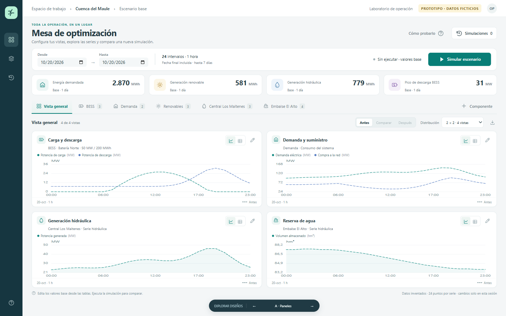
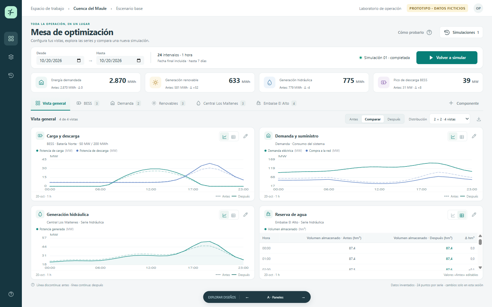

# Mesa de optimización

Plan de implementación solicitado el **20 de octubre de 2026** a partir del
prototipo que el usuario consideró adecuado. Este paquete reúne planificación,
contratos y evidencia visual. MESA-002 incorpora la primera consulta funcional
de demanda real desde el escenario.

- [Plan y decisiones aceptadas](plan_implementacion.md).
- [Tracker de las 14 entregas](tracker.md).
- [Estrategia de validación con TDD](validacion_tdd.md).
- [MESA-001: contratos y matriz de capacidades aceptados](decision_record_mesa001.md).
- [MESA-002: implementación, TDD y capturas](evidencia/MESA-002/validacion.md).
- [MESA-003: vistas persistidas, TDD y capturas](evidencia/MESA-003/validacion.md).
- [MESA-004: consulta eléctrica, resultados por activo y TDD](evidencia/MESA-004/validacion.md).
- [MESA-005: consulta hidráulica, identidad y TDD](evidencia/MESA-005/validacion.md).
- [MESA-006: edición canónica, concurrencia y TDD](evidencia/MESA-006/validacion.md).
- [MESA-007: ejecución eléctrica, recuperación y TDD con Julia real](evidencia/MESA-007/validacion.md).
- [MESA-008: ejecución hidráulica por versión, recuperación y TDD con Julia real](evidencia/MESA-008/validacion.md).
- [Contrato y migración de preferencias visuales](persistencia_vistas.md).
- [Capturas y reproducción de la referencia](referencias/README.md).
- [Copia autónoma del prototipo validado](referencias/prototipo-validado.html?variant=A).

El tracker es local, en Markdown, siguiendo la práctica existente del repositorio.
El usuario aprobó el desglose de 14 entregas, sus dependencias y clasificación
AFK/HITL, y confirmó las interfaces de prueba S1/S2 y S3 condicional el 2026-10-20.
Los tickets tienen triage ready-for-agent y criterios de aceptación. MESA-001
está **Done**, con capacidades e integración verificadas y contratos aceptados
por el usuario el 2026-10-20. El primer corte usa los modelos actuales: hidro
simple v2 integrado al balance eléctrico y red hidráulica v3 por su camino propio.
MESA-002 está **Done** y permite abrir **Escenario → Datos → Variante activa → Abrir mesa de
optimización**, consultar demanda en gráfico/tabla y recargar el mismo contexto.
MESA-003 está **Done**: pestañas, paneles, selección de series, modos y distribución
persistidos por usuario/caso, con conflictos recuperables y paneles ocultos conservados.
MESA-004 está **Done**: consulta de BESS, demanda y renovables, parámetros escalares
y selección de resultados existentes por activo con su procedencia.
MESA-005 está **Done**: centrales, embalses, unidades y tramos con identidad base/caso,
entradas con procedencia y resultados por entidad, incluidos los estados no disponibles.
MESA-006 está **Done**: edición de entradas canónicas en tabla, revisiones auditables,
copia local y conflictos recuperables, con protección de cambios pendientes.
MESA-007 está **Done**: preparación eléctrica por fechas, snapshot inmutable,
idempotencia y recuperación del run con avance real; éxito y fallo probados con Julia.
MESA-008 está **Done**: ejecución de una red v3 desde versión promovida, opciones
económicas, remuestreo explícito, huella revalidada, idempotencia y resultados por
central/embalse recuperables desde la mesa. Verificada con worker/Julia reales.
La siguiente entrega del orden recomendado es MESA-009, comparación eléctrica con procedencia.

El diseño acordado es **A · Paneles**: pestañas horizontales, matriz 2×2,
configuración de cada vista, gráficos/tablas y ejecución desde la misma pantalla.
Las alternativas B y C se conservan como referencia, no como tres implementaciones
obligatorias.

## Referencia visual

Estado inicial, 1440×900:

Comparación después de una simulación ficticia, con tres gráficos y una tabla:

Las capturas fijan la intención de diseño. Los números son inventados y no
constituyen resultados de referencia del optimizador.
